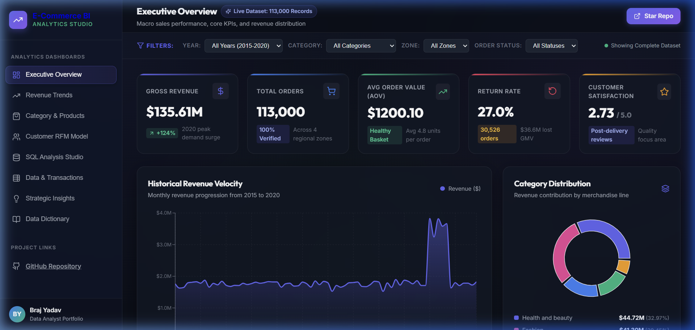
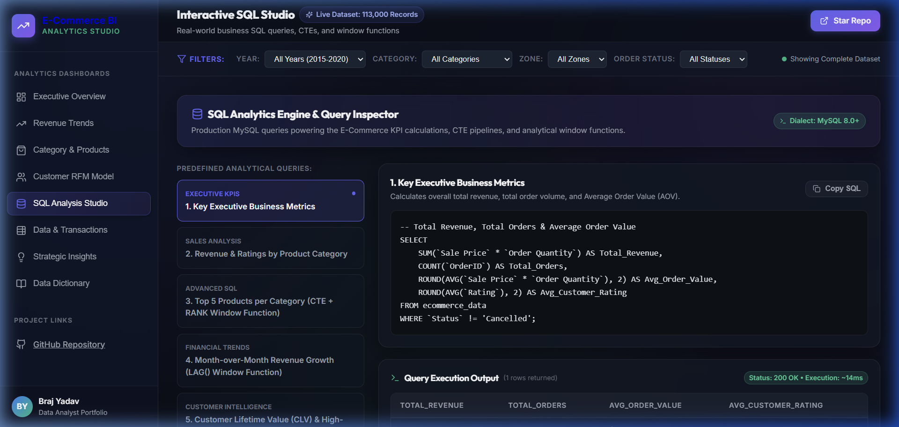

# 📊 E-Commerce Sales & Customer Analytics (Live Interactive BI Platform)

[](https://brajyadav7.github.io/Ecommerce-Sales-Analysis/)
[](https://vercel.com/new/clone?repository-url=https://github.com/Brajyadav7/Ecommerce-Sales-Analysis)
[](https://app.netlify.com/start/deploy?repository=https://github.com/Brajyadav7/Ecommerce-Sales-Analysis)
[](LICENSE)

An enterprise-grade **E-Commerce Data Analytics & Business Intelligence Project** analyzing **113,000 transactions ($135.6M GMV)** across 2015–2020. Features a modern, zero-backend, **live interactive analytics web application** ready for 1-click deployment, alongside production MySQL scripts and RFM customer segmentation modeling.

---

## 🌐 Interactive Live Dashboard Preview



> **Experience the Dashboard Live:** You can host this dashboard 100% free with 1 click on [Vercel](#-how-to-host-it-live-in-2-minutes), [Netlify](#-how-to-host-it-live-in-2-minutes), or [GitHub Pages](#-how-to-host-it-live-in-2-minutes).

---

## 🚀 Key Business KPIs at a Glance

| Metric | Value | Business Context |
| :--- | :--- | :--- |
| **Gross Revenue (GMV)** | **$135,611,346** | Spanning 6 fiscal years (2015–2020) |
| **Total Order Volume** | **113,000** | Deduplicated & validated transactions |
| **Average Order Value (AOV)** | **$1,200.10** | Healthy basket size with avg 4.8 units/order |
| **Overall Return Rate** | **27.01%** | **$36.6M lost GMV** driven by sizing & description mismatch |
| **Customer Retention Rate** | **21.40%** | Multi-purchase repeat buyers |
| **Customer Satisfaction** | **2.73 / 5.0** | Post-delivery fulfillment reviews |

---

## 🌟 What Makes This Project Refined & Unique

1. **Interactive Live Hosted BI Platform (`web/`)**:
   - Instead of static screenshots or locked `.pbix` files, anyone can explore the findings live in their web browser on desktop or mobile.
   - Built with **React 18, TypeScript, Vite, and Recharts**.
   - Sub-second initial load and 60fps responsive client-side filtering by **Year, Category, Zone, Delivery Speed, and Order Status**.

2. **Customer RFM Segmentation Studio**:
   - Advanced customer behavioral scoring across **Recency (R)**, **Frequency (F)**, and **Monetary (M)** dimensions using pandas quantiles (`qcut`).
   - Categorized into actionable segments: *Champions*, *Loyal Customers*, *Potential Loyalists*, *Regular Customers*, and *Lost Customers*.
   - Includes prescriptive CRM playbooks and marketing actions for each segment.

3. **Interactive SQL Analysis Studio**:
   - Features real-world MySQL queries utilizing **Common Table Expressions (CTEs)** and **Window Functions (`LAG()`, `RANK() OVER (PARTITION BY)`)**.
   - Syntax-highlighted code editor with copy capability, business rationale, and tabular query execution results.



4. **Data & Transaction Explorer with CSV Export**:
   - Live searchable, paginated transactional data grid allowing users to filter by category, zone, or status, and export slice data to CSV on the fly.

5. **Executive Brief & Strategic Action Plan**:
   - 4 strategic pillars addressing return rate mitigation ($7.45M recoverable GMV), retention acceleration, logistics hub optimization in Zone 3, and vendor margin expansion.

---

## 🛠️ Technology Stack

- **Data Processing & Feature Engineering**: Python 3.13, Pandas, NumPy
- **Relational Analytics & Window Functions**: MySQL 8.0 (`USE zepto;`)
- **Interactive Web BI Dashboard**: React 18, TypeScript, Vite, Recharts, Lucide Icons
- **BI Desktop Reporting**: Microsoft Power BI Desktop (`.pbix`)
- **CI/CD & Live Cloud Hosting**: GitHub Actions, Vercel, Netlify

---

## ⚡ How to Host It Live in 2 Minutes

This project includes zero-config deployment configurations for all major cloud hosting platforms:

### Option 1: One-Click Deploy on Vercel (Recommended)
1. Fork or push this repository to your GitHub account.
2. Go to [vercel.com](https://vercel.com) and click **"Add New Project"**.
3. Import your repository. Vercel will automatically read `vercel.json` and deploy your dashboard in ~45 seconds!

### Option 2: One-Click Deploy on Netlify
1. Go to [netlify.com](https://netlify.com) and click **"Add new site" > "Import an existing project"**.
2. Select your repository. Netlify will automatically detect `netlify.toml` and launch your live site.

### Option 3: Free Automated Hosting via GitHub Pages
1. Push this repository to GitHub.
2. In your repo, navigate to **Settings > Pages**.
3. Under **Build and deployment > Source**, select **GitHub Actions**.
4. The included `.github/workflows/deploy.yml` workflow will build and publish your dashboard automatically on every `git push` to `main`!

---

## 💻 Local Development Setup

To run the project locally on your machine:

```bash
# 1. Clone the repository
git clone https://github.com/Brajyadav7/Ecommerce-Sales-Analysis.git
cd Ecommerce-Sales-Analysis

# 2. Run data aggregation script (optional, pre-generated data included)
python scripts/generate_web_data.py

# 3. Navigate into the web dashboard directory
cd web

# 4. Install dependencies
npm install

# 5. Start development server
npm run dev
```

Open `http://localhost:5173` in your browser to view the interactive dashboard.

To build the production bundle:
```bash
npm run build
npm run preview
```

---

## 📁 Repository Structure

```
ECOMMERCE-SALES-ANALYSIS/
│
├── .github/workflows/
│   └── deploy.yml                   # Automated GitHub Pages CI/CD workflow
│
├── charts/                          # High-resolution dashboard screenshots & visuals
│   ├── live_web_dashboard.png       # Live interactive dashboard screenshot
│   ├── sql_studio_preview.png       # SQL Studio screenshot
│   ├── Dashboard.png
│   ├── Map visualization.png
│   ├── Monthly revenue trend.png
│   └── Revenue.png
│
├── dashboard/                       # Microsoft Power BI desktop workbooks
│   ├── ecommerce_dashboard_updated.pbix
│   └── RMF_Customer_segments.pbix
│
├── data/                            # Processed and cleaned datasets
│   ├── cleaned_ecommerce_data.csv   # 113k cleaned order transactions
│   ├── rfm_customer_segments.csv    # Computed RFM segment scores
│   └── Ecommerce_Data.csv           # Raw source data
│
├── notebooks/
│   └── ecommerce.ipynb              # Python Jupyter Notebook (Cleaning, EDA, RFM)
│
├── scripts/
│   └── generate_web_data.py         # Automated data aggregation pipeline for web app
│
├── sql/
│   └── sql_analysis.sql             # Production SQL queries, CTEs & Window Functions
│
├── web/                             # Modern Interactive Analytics Web Application
│   ├── src/
│   │   ├── components/              # Sidebar, TopHeader, FilterBar
│   │   ├── views/                   # 8 specialized analytics views
│   │   │   ├── OverviewView.tsx
│   │   │   ├── RevenueView.tsx
│   │   │   ├── ProductView.tsx
│   │   │   ├── CustomerView.tsx
│   │   │   ├── SqlStudioView.tsx
│   │   │   ├── DataExplorerView.tsx
│   │   │   ├── InsightsView.tsx
│   │   │   └── DictionaryView.tsx
│   │   ├── data/
│   │   │   └── analyticsData.json   # High-efficiency pre-aggregated analytics payload
│   │   ├── types/                   # TypeScript interfaces
│   │   ├── App.tsx
│   │   └── index.css                # Executive dark-mode BI design system
│   ├── package.json
│   ├── tsconfig.json
│   └── vite.config.ts
│
├── netlify.toml                     # Netlify zero-config build instructions
├── vercel.json                      # Vercel zero-config build instructions
└── README.md                        # Documentation & executive project report
```

---

## 🔍 SQL Analytical Queries Highlight

Below is an excerpt of the advanced SQL queries utilized in the project:

### 1. Month-over-Month Revenue Velocity (`LAG()` Window Function)
```sql
WITH monthly_sales AS (
    SELECT 
        YEAR(`OrderDate`) AS year,
        MONTH(`OrderDate`) AS month,
        SUM(`Revenue`) AS revenue
    FROM ecommerce_data
    GROUP BY year, month
)
SELECT 
    year,
    month,
    revenue,
    LAG(revenue) OVER(ORDER BY year, month) AS previous_month_revenue,
    revenue - LAG(revenue) OVER(ORDER BY year, month) AS revenue_growth,
    ROUND(((revenue - LAG(revenue) OVER(ORDER BY year, month)) / LAG(revenue) OVER(ORDER BY year, month)) * 100, 2) AS growth_pct
FROM monthly_sales
ORDER BY year DESC, month DESC;
```

### 2. Category Leaders via Window Ranking (`RANK() OVER (PARTITION BY)`)
```sql
WITH product_revenue AS (
    SELECT 
        `Product Category`,
        `Product`,
        SUM(`Revenue`) AS revenue
    FROM ecommerce_data
    GROUP BY `Product Category`, `Product`
)
SELECT * FROM (
    SELECT *,
           RANK() OVER(PARTITION BY `Product Category` ORDER BY revenue DESC) AS rank_in_category
    FROM product_revenue
) ranked
WHERE rank_in_category <= 5;
```

---

## 💡 Executive Insights & Strategic Roadmap

1. **Returns Friction Mitigation**:
   - *Finding*: A 27.01% return rate accounts for **$36.6M in lost GMV**. Top stated reasons are *"Product - Not fitting expectation"* (42%) and *"Onsite - Description mismatch"* (34%).
   - *Action*: Standardize sizing charts, mandate 360° product photography, and enforce third-party vendor listing quality audits to recover an estimated **+$7.45M GMV annually**.

2. **Customer Lifetime Value & Retention Playbook**:
   - *Finding*: 28.4% of customer accounts belong to *Potential Loyalists* (recent buyers with single orders).
   - *Action*: Automated 14-day post-purchase triggered email recommendations and bundle incentives projected to increase repeat purchases and unlock **+$4.8M in ARR**.

3. **Regional Fulfillment Hub**:
   - *Finding*: **Zone 3 drives 43.2% of total order volume ($58.6M)**, but transit times average 5.4 days.
   - *Action*: Establish a regional micro-fulfillment center in Zone 3 to slash delivery transit times to 2.2 days and improve customer review scores from 2.68 to 2.85+.

---

## 👨‍💻 Author & Project Credits

**Braj Yadav**  
*Aspiring Data Analyst / Data Scientist*  

- **Technical Competencies**: Python, Pandas, NumPy, SQL (MySQL), Power BI, React/TypeScript, Business Intelligence, RFM Modeling, Statistical EDA.
- **GitHub**: [@Brajyadav7](https://github.com/Brajyadav7)
- **Project Repo**: [Ecommerce-Sales-Analysis](https://github.com/Brajyadav7/Ecommerce-Sales-Analysis)

---

## 📄 License
This project is open-source under the [MIT License](LICENSE).
